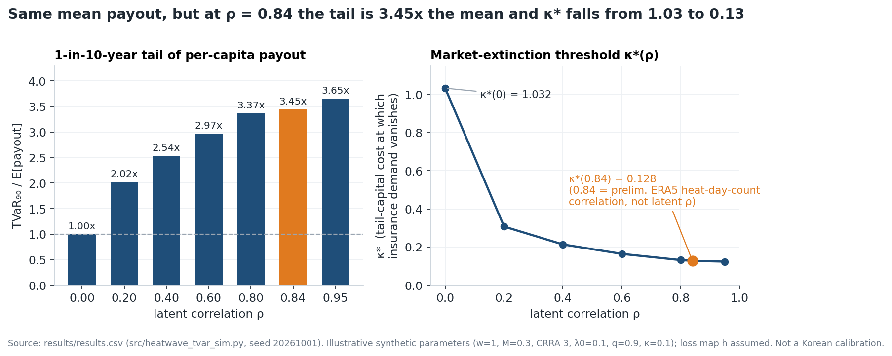
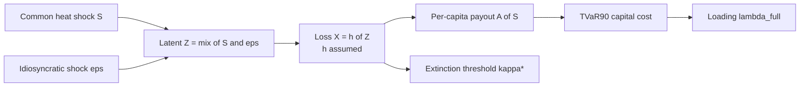
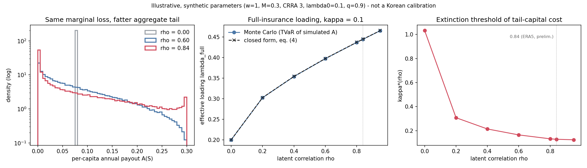

# Heat-Wave Income Insurance: Basis Risk and Correlated Heat Risk

A review of Jeju's parametric heat-wave income cover plus a TVaR-priced model showing that correlated heat losses leave the mean payout flat but push the 1-in-10-year tail to **3.45× the mean** and cut the market-extinction threshold from **1.03 to 0.13** (illustrative parameters).


<p align="center"></p>

| | |
|---|---|
| **Context** | SNU Actuarial Society, Sep 2026 – present (work in progress) |
| **Role** | Joint work with SNU Actuarial Society members; this repository is maintained by Do-hyun Lee |
| **Stack** | Python (numpy, matplotlib); Monte Carlo + Gauss–Hermite quadrature |
| **Data** | Simulation: synthetic, illustrative parameters. ERA5 reanalysis: public, not included (see [`data/README.md`](data/README.md)) |

> **Status: work in progress.** The theory paper is an unpublished draft (v0.3, Oct 2026). Every number from the theory comes from illustrative parameters, not a Korean calibration. The ERA5 statistics are preliminary and have not yet been checked against KMA ASOS station data.

## Key results

- **Tail, not mean.** Expected per-capita payout stays at **0.075** for every $\rho$, but $\mathrm{TVaR}_{0.9}$/mean rises from **1.00×** ($\rho=0$) to **3.45×** ($\rho=0.84$). With a finite pool of 1,000 workers the tail is **1.07×** at $\rho=0$ vs **3.48×** at $\rho=0.84$: pooling does not remove the common shock.
- **Price.** The effective full-insurance loading rises from **0.200** to **0.445** ($\rho=0.84$, $\kappa=0.1$); Monte Carlo matches the closed form to within 0.001.
- **Market extinction.** The threshold $\kappa^\ast(\rho)$ falls from **1.032** to **0.128** at $\rho=0.84$. In the draft's example, insurance survives up to a full-insurance loading of about **113%** at $\rho=0$, but only about **54–64%** once $\rho \ge 0.2$.
- **Korea is in the high-correlation regime (preliminary).** ERA5, 17 provinces, 1991–2025: mean inter-regional correlation of annual heat-wave days **0.84** (range 0.55–0.99). This is a correlation of heat-day counts, not of the model's latent $\rho$, and is not yet validated against KMA stations.

## Overview

The project has two parts.

1. **Market review (presentation).** A survey of how Korea insures climate risk (crop, aquaculture and storm/flood/earthquake disaster insurance; Gyeonggi's health-based climate insurance; Jeju's heat-wave work-stoppage income insurance), focused on Jeju's parametric cover. According to a Ministry of Climate, Energy and Environment official's remark at a 7 Sep 2026 public forum, it made essentially no payouts in its first season (a ministry statement, not an official Jeju statistic). The review sets out **three candidate basis-risk channels** in the trigger design; they are possible explanations, not proven causes.
2. **Theory paper (draft).** Why does private heat-wave income insurance tend to vanish? The paper keeps the Arrow–Mossin demand problem and replaces the exogenous loading with a price derived from the insurer's **TVaR-based tail-capital cost** on a portfolio of **correlated** heat losses. Correlation does not change the average price; it moves the price toward large losses. Pure deductibles stop being optimal, a coverage cap emerges, and the market disappears at a lower capital cost.

For an insurer or reinsurer the point is that heat-wave income risk is an **aggregate** risk: pooling removes idiosyncratic losses but not the common hot-summer shock, so the cost of tail capital ends up in the premium, and national expansion needs a pooling/reinsurance layer first.

**Jeju: three candidate basis-risk channels** (cannot be told apart until warning, timing and site-stoppage data are separated)

| # | Channel | Trigger condition | Why it could block payouts |
|---|---|---|---|
| 1 | **Trigger level** | "Critical warning": daily max apparent temperature ≥ 38 °C, only where ≥ 35 °C for 2+ days | Maritime climate: threshold may rarely be reached (a **calibration** problem) |
| 2 | **Timing** | Warning issued **before 1 p.m.** | Later same-day warnings do not count |
| 3 | **Work stoppage** | Site must **officially stop work** | Cover behaves like **indemnity** and loses the speed that justifies an index design |

## Approach



- Latent $Z = \sqrt{\rho}\,S + \sqrt{1-\rho}\,\varepsilon$ is standard normal for every $\rho$, so the marginal loss distribution is fixed; only dependence changes.
- 200,000 simulated years of $S$; $A(S)$ computed exactly over $\varepsilon$ by Gauss–Hermite; finite-pool check with 1,000 workers; $\kappa^\ast(\rho)$ from the draft's closed form.
- **The loss map $h$ is this repo's own assumption**: the draft does not publish it. A capped linear ramp is fitted to two numbers the draft reports, $\mathbb{E}[X]=0.075$ and $\kappa^\ast(0)=1.032$.

## Validation

| Check | Result |
|---|---|
| Monte Carlo vs closed-form $\lambda_{\text{full}}$ (eq. 4) | Agree to ≤ 0.001 at all 7 values of $\rho$ |
| Mean price coefficient independent of $\rho$ (Lemma 2(i)) | 1.2000 at $\rho$ = 0, 0.6, 0.95 (theory 1.2000) |
| Simulated $\lambda_{\text{full}}$ vs draft, $\rho$ = 0 / 0.2 / 0.4 / 0.6 / 0.8 / 0.95 | 0.200 / 0.302 / 0.354 / 0.397 / 0.437 / 0.465 vs draft 0.200 / 0.302 / 0.353 / 0.395 / 0.431 / 0.454 |
| $\kappa^\ast(\rho)$ vs draft | 1.03 → about 0.12–0.13 vs draft 1.032 → 0.127 |
| Loss vs latent correlation | Latent $\rho=0.84$ gives loss correlation 0.79 |

Differences at intermediate $\rho$ come from the assumed $h$.

## Reproduce

```bash
pip install -r requirements.txt
python src/heatwave_tvar_sim.py      # ~1 min, fixed seed; writes results/ and reports/figures/tvar_loading_vs_correlation.png
python reports/make_figures.py       # rebuilds reports/figures/hero.png from results/results.csv
```

The simulation is fully reproducible. The ERA5 statistics, the optimal-contract solution (Proposition 2), the clawback contract (Model B) and the trend model (Model C) are **not** reproducible from this repo; they exist only in the draft / separate analysis.

## Repository structure

```text
.
├── README.md
├── requirements.txt               # numpy, matplotlib (figure only)
├── src/
│   └── heatwave_tvar_sim.py       # Model A Monte Carlo + closed forms
├── results/
│   ├── results.csv                # per-rho table (used by the hero figure)
│   ├── results.txt                # formatted table + finite-pool check
│   └── console_output.txt         # full console log of the last run
├── reports/
│   ├── make_figures.py            # builds hero.png from results.csv
│   └── figures/
│       ├── hero.png               # README hero figure
│       └── tvar_loading_vs_correlation.png  # 3-panel figure from the sim
└── data/
    └── README.md                  # ERA5 source; data not included
```

## Limitations

- All model numbers use **illustrative, synthetic parameters**, not a Korean calibration.
- The loss map $h$ is **assumed** (not in the draft) and fitted to two reported numbers; exact values at intermediate $\rho$ depend on it.
- ERA5 statistics are **preliminary**, not validated against KMA ASOS stations; the ERA5 processing code and data are not in this repo. The 0.84 is a correlation of heat-day counts; the model's $\rho$ is a latent correlation, and loss correlation is lower than latent correlation.
- The "near-zero payouts" finding rests on one official's public forum remark, not an official statistic, and applies only to the Jeju construction-worker cover (Gyeonggi's climate insurance, for example, reported a 22% loss ratio).
- The three Jeju channels are candidate explanations; the zero-payout outcome is treated as a result of design choices, not proof that the scheme failed.
- The simulation does not solve for the optimal contract or simulate Models B and C.

<details><summary><b>Technical details</b></summary>

### Motivation: parametric insurance and basis risk

A **parametric (index) insurance** contract pays when an observable index crosses a trigger, for example an official heat warning. It does not pay on an assessed loss. This makes payouts fast and cheap to administer, and no proof of loss is needed. The cost is **basis risk**: the index payout and the insured's real loss can disagree. A worker can lose a day's wages to heat and still receive nothing.

Heat-wave income risk raises a second problem. It is **aggregate**: when one region has a hot summer, most of the country does too. Pooling many workers removes idiosyncratic risk but not the common shock. The insurer must therefore hold capital for bad years, and the cost of that capital ends up in the premium.

### The Jeju heat-wave income insurance

**Product (launched end of July 2026).** The cover is for daily construction workers on public construction sites worth KRW 100M or more who are enrolled in the retirement mutual-aid scheme. Workers and employers pay no premium. Funding is KRW 1.0bn over 3 years: KRW 0.9bn from an insurance-industry fund plus KRW 0.1bn from the province. The cover pays KRW 17,210 per hour, which is 80% of the standard laborer wage, for up to 4 hours (KRW 68,840 per day). It pays when a *heat-wave critical warning* is issued before 1 p.m. **and** work on the site is fully stopped.

**Payout record.** At a 7 Sep 2026 public forum, an official from the Ministry of Climate, Energy and Environment said he understood that *no claim had yet been paid*. This is a ministry statement, not an official Jeju statistic. It applies only to the Jeju construction-worker cover. Gyeonggi's climate insurance, for example, reported a 22% loss ratio.

| # | Channel | Trigger condition | Why it can block payouts | What it would mean |
|---|---|---|---|---|
| 1 | **Trigger level** | "Critical warning" tier (new 3-tier system since 1 Jun 2026): daily max apparent temperature ≥ 38 °C, only in areas that already had ≥ 35 °C for 2+ days | Jeju has a maritime climate, so the threshold may rarely or never be reached | A **calibration** problem: where to set the index threshold |
| 2 | **Timing condition** | Warning must be issued **before 1 p.m.** | A warning issued later the same day does not count | Index definition is narrower than the heat exposure it is meant to proxy |
| 3 | **Work-stoppage requirement** | The site must **officially stop work** | A warning at the right time still pays nothing unless the site halts | The "parametric" cover behaves like **indemnity** insurance and loses the speed that justifies an index design |

These are **candidate explanations**. They cannot be told apart until warning, timing and site-stoppage data are separated. The presentation therefore treats the zero-payout outcome as a result of design choices, not yet as proof that the scheme failed. The main lesson is about channel 3. A clause added to reduce basis risk can remove the main advantage of index insurance, which is automatic and fast payment.

The review's wider point: national expansion would not diversify the risk away, because heat waves hit the peninsula almost simultaneously. Expansion would first require a pooling and reinsurance layer. Today the Jeju scheme, at KRW 1bn, is too small to need one.

### Theory model (Model A: static optimal contract under correlated heat risk)

**Worker.** A worker earns seasonal income $w$ and suffers a bounded heat-related income loss $X \in [0, M]$, with $M < w$. Utility $u$ is increasing and strictly concave.

**Correlation structure.** A common heat shock $S$ and an idiosyncratic shock $\varepsilon$ are independent standard normals:

```math
Z = \sqrt{\rho}\,S + \sqrt{1-\rho}\,\varepsilon, \qquad X = h(Z),
```

where $h$ is non-decreasing and zero below a threshold. $Z$ is standard normal for every $\rho$, so the **marginal loss distribution does not depend on $\rho$**. Changing $\rho$ changes only the dependence between workers.

**Contracts.** Indemnities satisfy $I(0)=0$ and $0 \le I(x)-I(y) \le x-y$ for $y<x$: neither the payout nor the retained loss decreases as the loss grows.

**Insurer and TVaR capital loading.** With many policies the per-capita payout converges to $A(S) = \mathbb{E}[I(X)\mid S]$. The insurer holds capital for the worst $1-q$ years $T=\lbrace S>z_q\rbrace$ and prices at cost:

```math
\mathrm{Cost}(I) = (1+\lambda_0)\,\mathbb{E}[A(S)] + \kappa\,\mathrm{TVaR}_q\big(A(S)\big),
```

where $\lambda_0$ is a correlation-free base loading and $\kappa$ the opportunity cost of tail capital.

**State price coefficient.** The premium can then be written as

```math
P(I) = \mathbb{E}\big[I(X)\,\tilde m(X)\big], \qquad
\tilde m(x) = 1 + \lambda_0 + \kappa\,\frac{\pi(x)}{1-q}, \qquad
\pi(x) = \Pr(S \in T \mid X = x).
```

$\mathbb{E}[\tilde m(X)] = 1+\lambda_0+\kappa$ for every $\rho$, so correlation does **not** change the average price. It makes $\pi(x)$ increase with $x$, which moves the price toward large losses that occur in hot years. The effective loading of full insurance,

```math
\lambda_{\text{full}}(\rho) = \lambda_0 + \kappa\left[1 + \frac{\mathrm{Cov}\big(X,\pi(X)\big)}{(1-q)\,\mathbb{E}[X]}\right],
```

is non-decreasing in $\rho$.

**Objective.** The worker solves $\max_{I} \ \mathbb{E}\big[u\big(w - P(I) - X + I(X)\big)\big]$.

**Main results of the draft (stated informally).**

- *Contract shape.* If $\rho = 0$, Arrow's pure deductible $(x-D)^+$ is optimal. If $\rho \in (0,1)$ and $\kappa>0$, no pure deductible, including full insurance, is optimal. When a sign condition holds at the top of the loss range, a **coverage cap** appears endogenously, so the optimal contract becomes a layer.
- *Market extinction.* Insurance disappears ($I^\ast \equiv 0$) once $\kappa$ exceeds a threshold $\kappa^\ast(\rho)$, and $\kappa^\ast(\rho)$ is **non-increasing in $\rho$**. Losses are bounded, so this is a demand-side corner solution, not a non-diversification trap. In the draft's example, insurance survives up to a full-insurance loading of about 113% when $\rho=0$, but only about 54–64% once $\rho \ge 0.2$.
- *Extensions in the draft (not simulated here).* Model B adds a **clawback contract** that recovers the common-shock component from all members the following year. This turns tail capital into short-term liquidity and has zero expected fiscal cost under mandatory collection. Model C adds a **climate trend**. It gives a separation result for annual repricing, sustainability conditions for the clawback account, and a welfare decomposition of who bears the trend.

### Empirical results (preliminary)

ERA5 reanalysis, a representative point in each of 17 provinces, 1991–2025. A heat-wave day is a day whose maximum temperature is at or above that region's 1991–2020 June–September 95th percentile.

| Statistic | Value | Role in the model |
|---|---|---|
| Mean inter-regional correlation of annual heat-wave days | **0.84** (range 0.55–0.99) | $\rho$: high-correlation regime |
| Variance share of first principal component | 0.86 | One common factor $S$ is a reasonable approximation |
| Inter-regional correlation of the daily heat indicator | 0.52 | Same-day co-occurrence is much weaker than annual co-movement |
| National mean annual heat-wave days | 8.6 (max 34.5 in 2024) | Heavy right tail |
| Linear trend | +5.5 days per decade | Trend $g$ (Model C) |
| Detrended AR(1) | 0.19 | Low persistence, which favors the clawback design |

*Caveats.* These are preliminary estimates that have not been validated against ASOS. The ERA5 processing code and data are **not** in this repository. Also note that 0.84 is a correlation of heat-day **counts**, which are loss-like quantities. The model's $\rho$ is the correlation of the latent variable $Z$. Because $h$ is non-linear, loss correlation is lower than latent correlation. In the simulation, latent $\rho=0.84$ gives a loss correlation of about 0.79.

### Monte Carlo illustration (`src/`)

**Illustrative, synthetic parameters, not a Korean calibration.** [`src/heatwave_tvar_sim.py`](src/heatwave_tvar_sim.py) needs only numpy, plus matplotlib for the figure, and uses a fixed seed. It implements Model A as stated above:

1. It draws the common heat shock $S$ for 200,000 simulated years. It computes the per-capita payout $A(S)$ exactly over the idiosyncratic shock (Gauss–Hermite), then estimates $\mathrm{TVaR}_{0.9}(A)$ and the full-insurance loading. These are checked against the closed form for $\lambda_{\text{full}}$.
2. It simulates a finite pool (1,000 workers per year) to show that pooling removes idiosyncratic risk but not the common-shock tail.
3. It computes the extinction threshold $\kappa^\ast(\rho)$ from the draft's closed form.

The parameters are the draft's example values: $w=1$, $M=0.3$, CRRA $\gamma=3$, $\lambda_0=0.1$, $q=0.9$, $\kappa=0.1$. **One ingredient is my own assumption:** the draft does not publish the loss map $h$. I use a capped linear ramp, $h(z)=M\cdot\mathrm{clip}\big((z-z_0)/c,0,1\big)$ ("lost work-days × daily wage, capped at the season maximum"), and calibrate it to two numbers the draft reports: $\mathbb{E}[X]=0.075$ and $\kappa^\ast(0)=1.032$.

```
  rho    E[A]   sd(A)  TVaR90 TVaR/E[A]  lam_full MC  lam_full eq4  kappa*  lam_full@k*
 0.00  0.0751  0.0000  0.0751      1.00        0.200         0.200   1.032         1.13
 0.20  0.0750  0.0383  0.1518      2.02        0.302         0.303   0.308         0.72
 0.40  0.0750  0.0552  0.1903      2.54        0.354         0.354   0.214         0.64
 0.60  0.0750  0.0691  0.2229      2.97        0.397         0.398   0.165         0.59
 0.80  0.0750  0.0820  0.2525      3.37        0.437         0.437   0.132         0.55
 0.84  0.0750  0.0846  0.2582      3.45        0.445         0.445   0.128         0.54
 0.95  0.0749  0.0918  0.2739      3.65        0.465         0.466   0.124         0.55

Finite pool, N = 1,000 workers:  TVaR90 / mean = 1.07 (rho=0), 2.96 (rho=0.6), 3.48 (rho=0.84)
```



**How to read it.** Expected payout stays the same as $\rho$ rises, but the 1-in-10-year tail of the per-capita payout grows from 1.0× to about 3.5× the mean. With 1,000 workers and no correlation, pooling almost removes the tail (1.07×). With correlation, pooling does not help.

Exact values differ from the draft at intermediate $\rho$ because $h$ is assumed. Full output is in [`results/`](results/).

### Next steps

- **EM1:** bias-correct ERA5 against KMA ASOS station records and separate deterministic from stochastic trend (data being collected).
- **EM2:** estimate the loss coefficient, i.e. how heat-wave days translate into lost workdays and income for outdoor and construction day workers. Planned data: Economically Active Population Survey microdata and Construction Workers Mutual Aid Association workday records (requested).
- **EM3:** compute $\kappa^\ast(\hat\rho)$ and compare it with market loadings; cat-bond price multiples of 2.33–2.69× (Lane & Mahul, 2008) serve as a reference band. The pre-registered rejection rule: if the calibrated threshold exceeds market loadings, the "private market vanishes" hypothesis is rejected.
- **EM4:** compare certainty equivalents and fiscal costs of no insurance, the private optimum, a flat regional scheme, public reinsurance and clawback.
- For Jeju specifically: separate the three basis-risk channels using warning logs (timing and tier) and site-stoppage records.

### References

**Theory**
- Arrow, K. J. (1963). Uncertainty and the welfare economics of medical care. *AER* 53(5).
- Mossin, J. (1968). Aspects of rational insurance purchasing. *JPE* 76(4).
- Raviv, A. (1979). The design of an optimal insurance policy. *AER* 69(1).
- Myers, S. C. & Read, J. A. (2001). Capital allocation for insurance companies. *JRI* 68(4).
- Zanjani, G. (2002). Pricing and capital allocation in catastrophe insurance. *JFE* 65(2).
- Froot, K. A. (2001). The market for catastrophe risk: a clinical examination. *JFE* 60(2–3).
- Lane, M. & Mahul, O. (2008). Catastrophe risk pricing: an empirical analysis. World Bank PRWP 4765.
- Ibragimov, R., Jaffee, D. & Walden, J. (2009). Nondiversification traps in catastrophe insurance markets. *RFS* 22(3).
- Young, V. R. (1999). Optimal insurance under Wang's premium principle. *IME* 25(2).
- Doherty, N. A. & Dionne, G. (1993). Insurance with undiversifiable risk. *JRU* 6(2).
- Clarke, D. J. (2016). A theory of rational demand for index insurance. *AEJ: Micro* 8(1).
- Graff Zivin, J. & Neidell, M. (2014). Temperature and the allocation of time. *JOLE* 32(1).

**Korean market sources (presentation)**
- Ministry of Agriculture, Food and Rural Affairs (2026). 2026 crop insurance changes.
- Ministry of the Interior and Safety (2026); Kyunghyang Shinmun (Jun/Jul 2026) on storm & flood insurance take-up.
- Jeju Special Self-Governing Province (Jul 2026) press release; Jeju Domin Ilbo (Jul 2026).
- Headline Jeju (May 2026): three-tier heat-warning system effective 1 Jun 2026.
- Energy Economy News (7 Sep 2026): forum remarks on climate insurance payout record.
- Korea Insurance Newspaper (2026): industry co-benefit insurance with 7 local governments.

</details>

<details><summary><b>한국어 요약</b></summary>

> **상태: 진행 중(work in progress).** 논문은 미공개 초고(v0.3, 2026년 10월)다. 이론 수치는 모두 예시 파라미터에서 나온 값이며 한국 캘리브레이션이 아니다. ERA5 수치는 기상청 ASOS 검증 전 예비 추정치다.

**개요.** 서울대 보험계리학회 활동(2026.9–현재)으로 수행 중인 연구다. 두 부분으로 나뉜다.

1. **국내 기후보험 현황 발표.** 농작물재해보험, 양식수산물재해보험, 풍수해·지진재해보험, 그리고 지역형인 경기 기후보험과 제주 폭염 소득보험을 정리했다. 이어 제주 지수형 폭염 소득보험이 첫해에 사실상 지급 0건이었던 원인을 트리거 설계상의 세 가지 basis risk 경로로 나누었다. 0건은 주무부처 과장의 토론회 발언에 근거하며 공식 집계는 아니다.
2. **이론 논문 초고.** Arrow–Mossin 최적보험 틀은 그대로 둔다. 대신 외생적 부가보험료를 상관된 폭염 손실 포트폴리오의 TVaR 꼬리 자본비용에서 도출한 상태별 가격계수로 바꾼다.

**제주 폭염 소득보험의 세 가지 basis risk 경로**

| 경로 | 조건 | 의미 |
|---|---|---|
| ① 트리거 레벨 | 폭염 중대경보: 체감온도 38°C 이상이고, 35°C 이상이 2일 이상 관측된 지역 | 해양성 기후에서 발령 자체가 드물 수 있다. 캘리브레이션 문제 |
| ② 시간 조건 | 오후 1시 이전 발령 | 오후 늦게 발령된 경보는 제외된다 |
| ③ 작업중지 요건 | 현장의 공식 작업 중지 | 사실상 실손형으로 운영된다. 지수형의 신속성이 사라진다 |

세 경로는 데이터로 분리되기 전까지 **후보 설명**이다. 따라서 제도 실패로 단정하지 않는다.

**모형.** 위험 구조는 $Z=\sqrt{\rho}S+\sqrt{1-\rho}\varepsilon$, $X=h(Z)$다. 보험자 비용은 $(1+\lambda_0)\mathbb{E}[A]+\kappa\,\mathrm{TVaR}_q(A)$이고, 가격계수는 $\tilde m(x)=1+\lambda_0+\kappa\pi(x)/(1-q)$다. 상관은 평균 가격을 바꾸지 않고 가격을 대형 손실 쪽으로 재배치한다. 그 결과 다음이 따른다.

- 순수 deductible이 최적이 아니게 된다.
- 보상한도가 내생적으로 생긴다.
- 소멸 임계값 $\kappa^\ast(\rho)$가 상관에 비증가한다.

확장으로 환수형 계약(모형 B)과 기후 추세 모형(모형 C)을 다룬다.

**예비 실증.** ERA5 17개 시도(1991–2025)에서 연간 폭염일수의 지역 간 평균 상관은 0.84로, 모형의 고상관 영역에 해당한다. 그 밖의 수치는 다음과 같다.

- 제1주성분 설명력 0.86
- 10년당 5.5일 증가 추세
- 추세 제거 AR(1) 0.19

**시뮬레이션(`src/`).** 예시·합성 파라미터를 쓰며 numpy만 필요하고 시드는 고정이다. 공통 충격 하에서 1인당 지급액의 TVaR와 완전보험 부가보험료율을 계산하고, 소멸 임계값 $\kappa^\ast(\rho)$도 구한다. 손실함수 $h$는 초고에 공개되어 있지 않아 선형 램프로 가정했다. 이 $h$는 초고의 $\mathbb{E}[X]=0.075$, $\kappa^\ast(0)=1.032$에 맞췄다. 결과는 초고의 예시와 정성적으로 일치한다. $\lambda_{\text{full}}$은 0.200→0.465(초고 0.200→0.454), $\kappa^\ast$는 1.03→0.12(초고 1.032→0.127)다.

**다음 단계.**

- ASOS 검증
- 폭염일→근로일·소득 손실 계수 추정
- 시장 부가보험료율과 $\kappa^\ast(\hat\rho)$ 비교. 가설 기각 조건은 사전에 명시했다.
- 무보험·민간 최적·지자체형·공적 재보험·환수형의 후생·재정비용 비교

</details>
